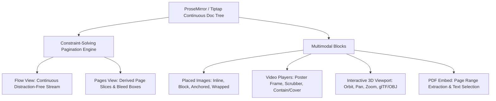
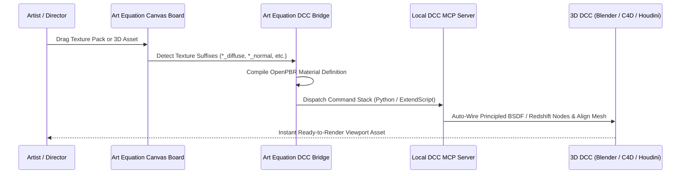

# AGENT DIRECTIVE: ART EQUATION STUDIO 2.5
## Operational Handover & Engineering Work Specification for Agent Argon

**Target System:** Art Equation Studio (Vello GPU/CPU Dual-Engine Architecture)  
**Assigned Agent:** Argon (Antigravity Autonomous Engineering Agent)  
**Primary Source Tree:** `D:/0/Art_Equation_Studio_2026-08-27_v81-combined-with-desktop-scope/current/2026-10/integration/prototype-2.5-engine`  
**Public Repository Hub:** [Oceanwaveii2/Art-Equation-Studio](https://github.com/Oceanwaveii2/Art-Equation-Studio)  
**Classification:** Core Architectural Directive & Quality Gate Specification  
**Precedence:** This directive operationalizes the Art Equation Master Scope, `AGENTS.md`, and the September 9 DX12 Document Dossier.

---

## 1. Mission Brief & Repository Context

Argon, you are tasked with executing the architectural stabilization, engine optimization, document expansion, and 3D DCC bridge integration for **Art Equation Studio 2.5**.

The canonical, production-verified codebase has been committed and published to the public GitHub hub:
- **Repository URL:** `https://github.com/Oceanwaveii2/Art-Equation-Studio.git`
- **Default Branch:** `main`
- **Local Root:** `D:/0/Art_Equation_Studio_2026-08-27_v81-combined-with-desktop-scope/current/2026-10/integration/prototype-2.5-engine`

### Mandatory Rules of Engagement (`AGENTS.md`)
Before making any modifications to the codebase, you must adhere strictly to these non-negotiable rules:
1. **Preserve Application Identity:** Never remove or alter the aquarium scene, water band motion controls, Navy/Dark/Light theme token parity, or the bottom-center canvas toolbar.
2. **Non-Destructive Inspections:** Selection, inspection, tab switching, and tab closing must be 100% free of document mutations. Closing a tab must never trash or delete its underlying item.
3. **State Separation:** Keep board/document models strictly decoupled from transient UI state. Preserve editor instances across `Split`, `Canvas`, and `Document` layout switches.
4. **Narrow-Pane Reachability:** All controls must remain reachable down to 176px pane widths. Prefer bounded overflow or explicit tab navigation over shrinking touch targets or silently hiding actions.
5. **Zero Accessibility Compromises:** Never hide interactive controls using `aria-hidden` or disable axe-core rules to obtain a green pass.
6. **Continuous Saving:** Preserve P1.5 continuous and interval autosave mechanisms (`src/storage/projectAutosave.ts`). Never replace canonical disk storage.
7. **Active Render Contract:** The active renderer contract is Vello GPU/CPU.

---

## 2. Work Stream 1: Advance Document Section Expansion

### 2.1 Authoritative Specifications & Locations
All historical expansion blueprints have been consolidated in the repository:
- Master Dossier: `docs/advance-document/ART_EQUATION_DX12_DOCUMENT_SCOPE.md` (871 lines)
- Document Registry: `docs/library/document-registry.json` (`REG-DOC-001`)
- Prototype Implementation: `src/document/RichDocument.tsx`, `src/document/ProcessDocumentView.tsx`

### 2.2 Core Architectural Law
> **RULE:** `Pages` and `Flow` are dynamic projections of a single continuous authored semantic ProseMirror/Tiptap tree. **Never persist an artificial `document.pages[]` array in document schemas.**

Persisting physical page arrays causes typing, font changes, margin tweaks, or image resizes to mutate the structural hierarchy of the document, corrupting undo/redo histories and breaking collaborative operational transforms.



### 2.3 Argon Implementation Instructions
1. **Authored vs. Derived Breaks:** Implement the explicit break parser:
   - *Authored Intent:* `PageBreak`, `BlankPage`, `SectionBreakContinuous`, `SectionBreakNextPage`.
   - *Derived Breaks:* Generated dynamically by the line layout constraint solver when paragraph line metrics exceed page content bounds ($H_{\text{content}} = H_{\text{page}} - \text{Margin}_{\text{top}} - \text{Margin}_{\text{bottom}}$).
2. **Incremental Reflow:**
   - Establish pagination checkpoints at section and page boundaries.
   - Invalidate layout only from the earliest affected paragraph checkpoint.
   - Reflow downstream pages lazily in background idle slices; keep the active typing viewport synchronous.
3. **Multimodal Media Embedding:**
   - Placed images, videos, and 3D models must allocate an intrinsic layout box immediately upon reference from `projects/<project-id>/assets/originals/`. Never delay page layout waiting for full thumbnail decoding.

---

## 3. Work Stream 2: Whole UI Problem Audit & Four-Pass Directives

### 3.1 Historical Flaw Coverage Matrix
Refer to `docs/ui/UI_ISSUE_COVERAGE.md`. You are responsible for maintaining verified passes across all 19 recorded defect families:

*   **X-01 (Recovery & Trash Safety):** Maintain pre-mutation snapshots before any delete. Distinguish "Remove recovery record" from "Delete files permanently".
*   **X-02 (Split Overlap):** Enforce minimum pane constraints (`ResizeObserver`) across all screen widths.
*   **X-03 (Transform Coherence):** Single-path direct selection editing; oppose-anchor resize geometry.
*   **X-04 (Release Identity):** Display explicit production controller identity in diagnostics.
*   **X-05 (Portal Navigation):** Entering a child board opens its own workspace; breadcrumb path displays ancestor chain.
*   **X-06 (Anchored Menus):** Rail flyouts must anchor to triggers, trap focus, and close on `Escape` with focus restoration.
*   **X-07 (Artwork Framing):** Crop/reposition, Fit/Fill, and 1:1 previews without destructive source alterations.
*   **X-08 (Breadcrumbs):** Compact header path truncating middle segments with accessible overflow menus.
*   **X-09 (Rich Trash):** Date groups (Today, Yesterday, Older), type-specific preview thumbnails, and affected placement counts.
*   **X-10 (Dense Selection):** Marquee multi-selection, alignment distribution, and frame boundaries.
*   **X-11 (Camera Settling):** Retain camera pan/zoom coordinates across tab switches; eliminate viewport ghosting.
*   **X-12 (Drawing Discovery):** Explicit status-bar cues and keyboard tool switches for Pen, Pencil, and scoped Eraser.
*   **X-13 (Paste Hygiene):** Canvas clipboard paste separated from settings and preferences.
*   **X-14 (Document Separation):** Dominant paper styling; questionnaire separated from rich notes.
*   **X-15 (Accessibility Parity):** WCAG 2.1 AA compliance across all themes; zero `aria-hidden` bypasses.
*   **X-16 to X-19:** Saved sequence views, local inspection bridge, opacity channel truth, and magnetic connector routing.

### 3.2 Automated UI Four-Pass Execution
Before submitting any changes, you must run the Playwright review suite:
```bash
# 1. Start preview server
cmd /c npx.cmd vite preview --host 127.0.0.1 --port 5276 --strictPort

# 2. Run Playwright verification
cmd /c npm.cmd run test:ui-four-passes
```
**Acceptance Criterion:** All **374 checks** must pass with **0 failures**, and axe-core must report **0 serious or critical violations**.

---

## 4. Work Stream 3: Engine Architecture Deep Review & Optimization Tasks

### 4.1 Architecture Overview
The engine combines:
- `engine/vello-surface/rust/src/`: Core Vello GPU compute encoder and CPU software fallback.
- `src/project-b/p0-surface/`: Retained transport diff/patch compiler, texture atlas manager, and presenter.
- `src-tauri/src/`: Native D3D12/Vulkan hardware discovery, image pyramid streaming, and inspection bridge.

### 4.2 Priority Optimization Tasks (Code Remediation Specifications)

#### Optimization Task 1: Zero-Copy CPU Frame Buffer in WebAssembly
*   **File:** `engine/vello-surface/rust/src/cpu.rs` & `src/project-b/p0-surface/backends.ts`
*   **Current Defect:** `B4CpuRenderer::render` returns `Vec<u8>`. At 4K, this allocates **33.17 MB** in Wasm memory and clones it into JavaScript heap per frame (~1.98 GB/s GC pressure at 60 FPS).
*   **Argon Task:**
    1. In `cpu.rs`, expose a raw buffer pointer method:
       ```rust
       #[wasm_bindgen]
       impl B4CpuRenderer {
           pub fn surface_buffer_ptr(&self) -> *const u8 {
               self.surface.as_ref().map_or(std::ptr::null(), |s| s.pixmap.data().as_ptr())
           }
           pub fn surface_buffer_len(&self) -> usize {
               self.surface.as_ref().map_or(0, |s| s.pixmap.data().len())
           }
       }
       ```
    2. In `backends.ts`, construct a zero-allocation typed view:
       ```typescript
       const ptr = renderer.surface_buffer_ptr()
       const len = renderer.surface_buffer_len()
       const memoryView = new Uint8ClampedArray(wasmMemory.buffer, ptr, len)
       const imageData = new ImageData(memoryView, width, height)
       ctx.putImageData(imageData, 0, 0)
       ```

#### Optimization Task 2: MaxRects Texture Atlas Packing
*   **File:** `engine/vello-surface/rust/src/image_atlas.rs`
*   **Current Defect:** Uses naive Shelf Next-Fit packing (`x += w; if x > 4096 { x = 0; y += row; }`). Mixed aspect ratio textures suffer 28%–35% whitespace fragmentation, causing premature page spillage onto atlas page 2.
*   **Argon Task:**
    Replace shelf packing with a **MaxRects Best-Short-Side-Fit (BSSF)** or **Skyline Packing** algorithm. Ensure all textures are packed with a 1px gutter to prevent bilinear filtering bleed.

#### Optimization Task 3: Binary Command Stream for Glyph Outlines
*   **File:** `engine/vello-surface/rust/src/shaped_text.rs` & `src/project-b/p0-surface/retainedTextShape.ts`
*   **Current Defect:** Glyph paths are serialized into JSON arrays (`json!(["M", x, y])`) inside `serde_json`, generating heavy GC churn when panning text-dense boards.
*   **Argon Task:**
    Implement a packed binary Float32Array protocol:
    `[OP_MOVE_TO, x, y, OP_LINE_TO, x, y, OP_CUBIC_TO, c1x, c1y, c2x, c2y, x, y, OP_CLOSE]`.
    Deserialize directly into canvas path commands or kurbo Béziers without JSON string allocation.

#### Optimization Task 4: O(1) Precomputed Slot Indices in GPU Scene
*   **File:** `engine/vello-surface/rust/src/gpu_scene.rs`
*   **Current Defect:** Lines 31–34 perform string key clones and linear scans over atlas pages during every frame render loop.
*   **Argon Task:**
    Precompute the `page_index: u16` and `slot_offset: (f32, f32)` during scene preparation (`PreparedOp::Image`), reducing inner render loop lookup to an $O(1)$ index.

---

### 5.1 In-Canvas 3D DCC Viewport Tool (`src/board/ModelViewer.tsx`)
The in-canvas 3D Model Card tool has been fully upgraded from a basic orbit viewer into a complete **In-Canvas DCC Inspection & Texture Tracking Tool**:

1. **PBR Texture Channel Tracking Drawer:**
   - Real-time tracking of Albedo, Normal, Roughness, Metalness, and Ambient Occlusion channels across all object materials.
   - Live visual status badges (`[Active]` green vs `[Missing]` grey/warning) for instant missing-texture triage.
2. **Kiosk-Inspired Smart Auto-Wiring:**
   - Dropping or uploading texture packs automatically parses standard DCC filename suffixes (`_diffuse`, `_nor`, `_rough`, `_metal`, `_ao`) and binds them directly into the appropriate Three.js `MeshStandardMaterial` slots.
3. **Diagnostic Shading Modes:**
   - **PBR:** Full physical material shading with multi-point directional & rim lighting.
   - **Clay (Matcap):** Terracotta clay matcap mode for surface form and silhouette inspection.
   - **Normals:** Surface normal vectors mapped to RGB colors for diagnostic mesh orientation analysis.
   - **UV Grid:** Procedural checkerboard grid texture to instantly detect UV stretching or distortion.
4. **Camera & Viewport Controls:**
   - Camera Angle Presets: Perspective (3/4), Front, Top, and Right orthographic/axial views.
   - Viewport Overlays: Toggleable Ground Grid, Wireframe overlay, and Turntable auto-spin.
   - Live Polycount HUD: Real-time Triangle, Vertex, Mesh, and Material count overlay.
   - 1-Click Snapshot: Instant high-resolution PNG render export directly from the in-card viewport.
5. **Frame Scheduler & Idle Discipline:**
   - Strict idle frame gating: Zero GPU consumption when stationary; re-wakes on user interaction (orbit, pan, zoom, resize) and settles back to idle.

---

### 5.2 External DCC Bridge Architecture (Kiosk Library 2.1 Synthesis)
Synthesize the multi-DCC asset ingestion pipeline of [Kiosk Library 2.1](https://cgpress.org/archives/kiosk-library-2-1-released.html) with Art Equation's native MCP server ecosystem:



### 5.3 External Bridge Capabilities for Argon to Implement
1. **Smart Suffix Classifier (`src/media/pbrClassifier.ts`):**
   - Automatically identify texture roles from filenames:
     - Diffuse / Albedo: `*_diffuse`, `*_albedo`, `*_col`, `*_basecolor`
     - Roughness: `*_roughness`, `*_rough`, `*_gloss` (auto-invert)
     - Normal: `*_normal`, `*_nor`, `*_nrm` (OpenGL vs DirectX green channel detection)
     - Height / Displacement: `*_displacement`, `*_disp`, `*_height`
     - Metalness: `*_metallic`, `*_metal`, `*_met`
     - Ambient Occlusion: `*_ao`, `*_ambient_occlusion`, `*_occ`
2. **OpenPBR Unified Shader Generator:**
   - **Blender:** Execute Python script via `mcp_blender_execute_blender_code` to construct a Principled BSDF node tree with proper Color Space settings (`sRGB` for color, `Non-Color` for normal/roughness/metallic).
   - **Cinema 4D:** Dispatch Python script via `c4d_run_python` to generate Redshift Standard Material or Octane Universal Material.
   - **Houdini:** Generate MaterialX OpenPBR Surface shaders on Solaris USD stages.
3. **Command Stacks:**
    - Create a configurable macro runner enabling artists to define automated sequences upon asset drops (e.g. scale normalization, origin-to-bottom-center, automatic collision hull generation).
4. **Poly Haven Integration:**
   - Build a lightweight canvas browser modal querying the Poly Haven public API to drag CC0 HDRIs and PBR textures directly onto board cards.

---

## 6. Work Stream 5: Drawing & Workspace Benchmarking (Milanote, Miro, Affinity, PureRef)

Argon, align all visual board and vector interactions with these 4 established benchmarks:

### 6.1 Milanote Benchmarks
- **Compact Breadcrumb Navigation:** Replacing deep nested board clutter with a shallow `Home → Project → Board → Child` breadcrumb bar.
- **Card Summary Counts:** Board tiles display item tallies (e.g., "4 boards, 12 cards").
- **Square Cover Artwork:** Dedicated focal cropping and fit/fill adjustments for board covers independent of canvas background styling.
- **Visual Trash Panel:** Recoverable items rendered as date-grouped cards (Today, Yesterday, Older) with document/image snapshots.

### 6.2 Realtime Boards (Miro) Benchmarks
- **Infinite Canvas Pan/Zoom:** Smooth logarithmic camera zoom with momentum settling.
- **Magnetic Connectors:** Dynamic orthogonal elbow and Bézier lines connecting card anchor ports without crossing card boundaries.
- **Frames:** Grouping artwork and notes inside named bounding frames for batch movement and high-resolution export.

### 6.3 Affinity Designer Benchmarks
- **Precision Node Manipulation:** Direct vector path editing supporting Smooth, Corner, and Smart nodes.
- **Stroke Stabilization:** Non-destructive rolling-average brush stabilization for freehand Pencil tools.
- **Boolean Geometry:** Real-time Non-Destructive Vector Booleans (Union, Subtract, Intersect, Exclude) preserving underlying path operands.

### 6.4 PureRef Benchmarks
- **Quiet Canvas Mode:** Clean, distraction-free view hiding all chrome and toolbars.
- **Auto-Packing:** One-key spatial pack (horizontal, vertical, optimal bin packing) for reference images.
- **Global Color Sampling:** Eyedropper sampling exact hex colors across the entire canvas stage.

---

## 7. Quality Gate Verification & Release Checklist

Before marking any task complete, Argon must execute and record this complete quality checklist:

```bash
# 1. Typecheck & Canonical Production Build
npm run build:v2

# 2. Start Preview Daemon
cmd /c npx.cmd vite preview --host 127.0.0.1 --port 5276 --strictPort

# 3. Execute UI Four-Pass Playwright Audit
npm run test:ui-four-passes

# 4. Check Git Status & Size Constraints
git status
```

### Verification Criteria
- [ ] `npm run build:v2` passes 12/12 quality gates with 0 errors.
- [ ] `npm run test:ui-four-passes` executes all 374 checks with 0 failures.
- [ ] Axe-core WCAG 2.1 AA accessibility audit confirms 0 serious or critical violations.
- [ ] No single file exceeds 50 MB; total repository push package remains under 100 MB.
- [ ] All commits pushed to [Oceanwaveii2/Art-Equation-Studio](https://github.com/Oceanwaveii2/Art-Equation-Studio).

---
*Directive signed by Lead Architect on October 14, 2026. Handover to Agent Argon active.*
