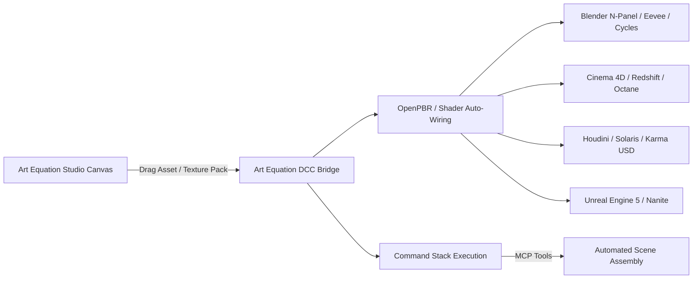

# 3D DCC Expansion Blueprint: Art Equation & Kiosk Library 2.1 Integration

**Target Architecture:** Art Equation Studio 2.5 / 2.6  
**Reference Specification:** [Kiosk Library 2.1](https://cgpress.org/archives/kiosk-library-2-1-released.html) (by Kiosk Software)  
**Scope:** Multi-DCC Visual Asset Bridge, Automated Shader Wiring, Command Stacks, and Live Studio Pipeline  

---

## 1. Executive Summary & Opportunity

Kiosk Library 2.1 introduces a lightweight, 100% offline-first digital asset management (DAM) and automated asset ingestion pipeline for 3D VFX artists across Blender, Cinema 4D, Autodesk Maya, Houdini, Unreal Engine 5, and 3ds Max. 

Art Equation Studio already features:
- A high-performance Vello GPU/CPU dual-engine canvas with spatial indexing.
- Retained card layout systems with reference boards, video scrubbers, and rich documents.
- Native Model-bundle / glTF 3D scene preview support.
- Fully wired Model Context Protocol (MCP) servers for **Blender**, **Cinema 4D**, **After Effects**, **DaVinci Resolve**, **Photoshop**, **Illustrator**, **Nuke**, and **Marvelous Designer**.

By integrating Kiosk Library 2.1's core design patterns—specifically its **OpenPBR / Standard Surface Auto-Wiring engine** and **Command Stacks (macro Python sequences)**—Art Equation expands from a 2D reference & document board into a **Unified 2D/3D Production Bridge Studio**.



---

## 2. In-Canvas 3D Model Viewer Object DCC Tool (`src/board/ModelViewer.tsx`)

> **User Design Directive:** *"The 3D DCC things means the canvas has the ability to import 3D object and track texture but it been neglected xD so I am talking about the 3D viewer object DCC tool."*

The core canvas has native support for 3D model cards (`node.kind === 'model'`). Previously, this viewer was limited to simple orbit rotation without texture management or shader diagnostics. The upgraded **In-Canvas 3D DCC Tool** upgrades each canvas model card into an interactive DCC preview station:

### 2.1 PBR Texture Channel Tracking Drawer
* **Live Material Inspection:** Scans all meshes in the scene and builds an active inventory of material slots.
* **Five-Channel Tracking:** Tracks Albedo, Normal, Roughness, Metalness, and Ambient Occlusion (AO).
* **Visual Status Badges:** Displays `[Active]` (green) vs `[Missing]` (warning) for every channel on every material slot.

### 2.2 Kiosk-Inspired Smart Auto-Wiring
* **One-Click Relinking:** Artists can drop a folder or batch of image textures onto the model card.
* **Filename Suffix Detection:** Automatically matches:
  - Diffuse/Albedo: `_diffuse`, `_albedo`, `_col`, `_basecolor`
  - Normal Maps: `_normal`, `_nor`, `_nrm`
  - Roughness: `_roughness`, `_rough`, `_gloss`
  - Metalness: `_metallic`, `_metal`, `_met`
  - Ambient Occlusion: `_ao`, `_ambient_occlusion`, `_occ`
* Automatically creates `THREE.CanvasTexture` / `THREE.Texture`, configures correct color space (`SRGBColorSpace` for color, Linear for data maps), and wires them directly into Three.js `MeshStandardMaterial`.

### 2.3 Diagnostic Shading Modes
* **PBR (Full Lit):** Standard physically based rendering with multi-light setup (Hemisphere ambient, Key directional with shadow mapping, Rim light).
* **Clay (Matcap):** Terracotta matte clay shading for pure silhouette, topology, and sculptural form inspection without texture distractions.
* **Normals:** Surface normal vectors mapped directly to RGB colors for diagnostic mesh orientation analysis and flipped normal detection.
* **UV Grid:** High-contrast procedural checkerboard grid texture to instantly detect UV distortion, seam errors, and texture stretching.

### 2.4 Viewport Lighting & Camera Controls
* **Lighting Presets:** Studio Neutral (3-point), Sunset Golden Hour, Noir High-Contrast, and Flat Diagnostic.
* **Camera Angle Presets:** Perspective 3/4, Front Orthographic, Top Down, and Right View.
* **Display Overlays:** Ground grid toggle, Wireframe overlay, and Turntable auto-rotation.
* **Geometry HUD:** Live Polycount overlay displaying triangle count, vertex count, mesh count, and material count.
* **1-Click High-Res Snapshot:** Instant PNG capture of the current 3D viewport view saved to disk.

---

## 3. Key Architecture Pillars Inspired by Kiosk Library 2.1

### 2.1 100% Local-First Asset Hub & Smart Material Detection
- **Offline Indexing:** Assets reside in `projects/<project-id>/assets/originals/` with persistent UUIDs and local SQLite/JSON caches. Zero cloud lock-in.
- **Smart Suffix Matching:** Texture packs are automatically detected by filename semantics:
  - Base Color / Diffuse: `*_diffuse`, `*_albedo`, `*_col`, `*_basecolor`
  - Roughness / Glossiness: `*_roughness`, `*_rough`, `*_gloss` (with auto-inversion)
  - Normal: `*_normal`, `*_nor`, `*_nrm` (with OpenGL vs DirectX green channel detection)
  - Height / Displacement: `*_displacement`, `*_disp`, `*_height`
  - Metallic / Metalness: `*_metallic`, `*_metal`, `*_met`
  - Ambient Occlusion: `*_ao`, `*_ambient_occlusion`, `*_occ`
  - Emission: `*_emissive`, `*_emit`
  - Opacity / Alpha: `*_opacity`, `*_alpha`, `*_mask`

### 2.2 OpenPBR & Standard Surface Unified Shader Generator
Rather than requiring manual shader graph assembly in every DCC:
1. **Blender:** Generates Principled BSDF node network with non-color data set on utility maps and normal map nodes inserted automatically.
2. **Cinema 4D:** Constructs Redshift Standard Material or Octane Universal Material nodes with proper color spaces (ACEScg / sRGB).
3. **Houdini / Solaris:** Builds MaterialX OpenPBR Surface shaders compatible with Karma CPU/XPU and USD stages.
4. **Unreal Engine 5:** Generates Material Instance Dynamic (MID) linking texture parameters to master PBR shaders.

### 2.3 Command Stacks (Automated Python Macro Pipelines)
Kiosk Library 2.1's defining capability is **Command Stacks**—allowing technical directors and artists to chain Python commands that trigger immediately upon asset import.

Art Equation implements this via its native MCP integration:
```python
# Example Art Equation Command Stack for Blender Asset Drop
stack = [
    {"action": "import_mesh", "file": asset.source_path},
    {"action": "auto_wire_pbr", "material_name": asset.name, "textures": asset.texture_set},
    {"action": "apply_transform", "scale": [1.0, 1.0, 1.0], "align_to_floor": True},
    {"action": "assign_collection", "collection": "Props_Imported"}
]
```

### 2.4 Poly Haven & Public Repository Browser
- Embedded non-destructive client to search and stream CC0 HDRIs, PBR textures, and models directly onto canvas moodboards.
- Dragging an HDRI onto a canvas card creates an environment lighting preset that can be dispatched to Blender World nodes with one click.

---

## 3. Implementation Roadmap

| Milestone | Target | Capabilities |
| :--- | :--- | :--- |
| **Phase 1: Asset Classification** | v2.5.1 | Filename parser for PBR texture sets; 3D model inspector (OBJ, FBX, GLTF) with triangle count and texture references. |
| **Phase 2: Blender MCP Bridge** | v2.6.0 | Direct drag-and-drop from Art Equation board into Blender viewport via `mcp_blender_execute_blender_code`. Automated Principled BSDF graph setup. |
| **Phase 3: Command Stacks** | v2.6.2 | JSON-configurable action chains for asset post-processing (scale normalization, origin centering, UV checks). |
| **Phase 4: Cinema 4D & Houdini** | v2.7.0 | MaterialX export and Redshift shader network generation via C4D/Nuke MCP connections. |
