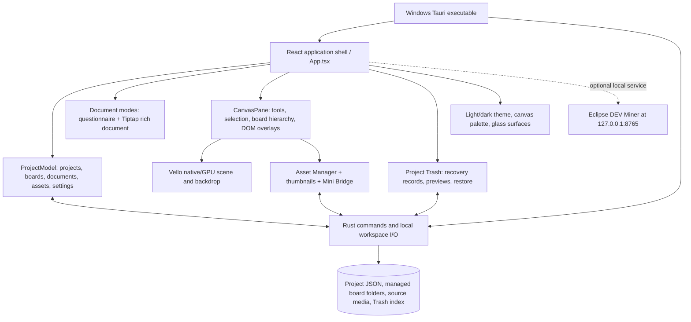

# Art Equation — Part I: current-state architecture and UI audit

Date: 2026-09-27. Status: **initial evidence-backed baseline, not a claim that every control has been manually tested**. This is the dated entry point for the planning/review/launch-preparation study. Preserve the earlier [library](../library/) and [history](../history/) as source records; their September 23 coverage and unresolved contradictions remain valid for their date.

The separate [UI/UX standards comparison](ART_EQUATION_PART_I_UI_UX_STANDARDS_COMPARISON_2026-09-27.md) scores current interaction evidence against Windows and W3C guidance.

## Evidence and build identity

- **Source inspected:** `desktop-app/src/App.tsx`, `App.css`, `model/{project,trash,vector}.ts`, `board/`, `document/`, `media/`, `storage/workspace.ts`, and `src-tauri/src/lib.rs`. The working tree contains extensive pre-existing changes; this review does not normalize or discard them.
- **Latest catalogued GLM executable:** `desktop-app/builds/glm-2026-09-25/Art Equation Studio - GLM Rotation-Aware Vectors 2026-09-26.exe`, SHA-256 `97FDC3E0741B24259A3CB514785830E868F2131CC72ED28C0A4B6B41A58AE486`; see [executable catalog](../../desktop-app/builds/EXECUTABLE_CATALOG.md). It has an independent workspace beside the EXE, not the main `portable/` data. This identifies the audit candidate, **not** the default launcher or a production release.
- **Fresh automated check, September 27:** `npm run test:vector-geometry` passed. The built `dist-vello` frontend passed 190/190 UI checks against Vite preview; [report](../../desktop-app/artifacts/ui-validation/report.json). These checks exercise a browser build, not the native executable, filesystem Trash, Windows display scaling, or every settings command. The catalog records a previous native build/startup smoke test. A native process started and initialized a writable workspace during this review, but reliable native screen/control interaction was unavailable; native button-by-button results remain **unverified**.
- **Visual samples:** [startup](../../desktop-app/artifacts/ui-validation/01-wide-dark-workspace.png), [canvas toolbar](../../desktop-app/artifacts/ui-validation/03-canvas-toolbar.png), [light shell](../../desktop-app/artifacts/ui-validation/02-wide-light-workspace.png), [compact width](../../desktop-app/artifacts/ui-validation/09-compact-width.png). These are generated test captures, not evidence of the owner's populated native workspace.

Evidence labels below: **A** = fresh automated behavior, **S** = current source, **V** = fresh visual capture, **O** = owner report/reference, **U** = not yet verified in native app. An intended action is not marked “works” merely because its button renders.

## Architecture map

The UI is a single project workspace with Document / Split / Canvas views. A project owns top-level boards, optional nested subboards, documents and assets. Top-level boards are intended to have managed disk folders; nested boards may have a folder link. A square subboard portal is an object on its parent canvas, while the child board is a separate board entity. The document layer is separate from the canvas renderer; proposed page rails and the Production Notebook remain future concepts, not current persisted page entities. The older DX12 branch is historical/retired, not the target renderer. See the [feature map](../library/feature-map.html), [UI reference](../library/ui-reference.html), and [contradiction register](../library/contradictions.csv) for the dated provenance.

## Current control and surface inventory

| Surface / control | Intended action or state | Evidence now | Manual/native gap |
|---|---|---|---|
| Startup / Enter now | Dismiss startup and enter workspace | V, A | Confirm current edition wording and skip focus in EXE |
| Project switcher, search, “This project” | Select/find project, scope search | S, V | Search/no-result and project switch on native data |
| Document / Split / Canvas | Change workspace composition | A, V | State retention after restart |
| Undo / Redo / Save | History and persistence | A for sampled canvas flows; S | Cross-document/board boundary and failed-save feedback |
| Project tools menu | Secondary project actions | S, V | Every item and dismissal/keyboard behavior |
| Settings / theme toggle | Preferences, rendering state and theme | A for theme; S | Item-level settings matrix, persistence, fallback |
| Project list / + Project / sort / archive | Project creation and navigation | S, V | Create/rename/archive/trash on disposable native fixture |
| Navigator workspace tree / + | Documents, root boards, nested boards and project systems | A for sampled board flows; V | Full hierarchy, long names, keyboard traversal |
| Navigator ⋯ item menus | Rename, duplicate, Trash and contextual actions | A for sampled board/document; S | Consistent commands across every item type |
| Hideable navigator and inspector tabs | Reclaim space, restore panes | S, V | All combinations, focus/persistence at 150–200% |
| Breadcrumb, back/forward/up | Current board location and history | A for sampled subboards; V | Deep nesting and missing/deleted ancestors |
| Board filmstrip and bottom project-board strip | Board navigation and preview | S, V | Differentiation and narrow-window overflow |
| Document controls / print / PDF | Edit structured/rich content and export | A for document Trash round trip; S | Long document, print pagination, video/embed persistence |
| Canvas rail: select/direct select/pen/shapes/text | Draw/edit/select cards and vectors | A for sampled shape/vector flows; V | Tablet/stylus, high-DPI, full gesture matrix |
| Canvas rail: blue Board / More | Create portal without entering child; reveal infrequent tools | A for sampled portal flow; V | Keyboard menu/command coverage, discoverability |
| Canvas contextual topbar: Color/Assets/Appearance | Properties, media and board appearance | A for sampled states; V | Every submenu, outside-click/Escape return focus |
| Appearance: grid/B&W/board/arrange/view | Canvas options and layout commands | S, V | Grid/B&W render vs export, arrange edge cases |
| Context menus / clipboard | Cut, copy, paste, duplicate, rename and Trash | A for sampled shape menu; S | Consistent target, clipboard formats, touch/keyboard |
| Selected-object inspector vs project inspector | Show context properties and project health | S, V | Selection updates and empty/multi-select states |
| Asset Manager / media preview / open-with | Catalog, import, relink, preferred app | A for shell; S | File type fidelity, relink, large TIFF/OBJ/video |
| Mini Bridge | Disk-to-canvas identity, folder/status/recovery views | A for shell; S | Native filesystem edge cases and scale |
| Trash entry/popover | Preview before restore or record removal | A for sampled document/board/node; V | Native disk effects, nested/asset impact and wording |
| Minimap / zoom / fit / pan | Navigate large canvas | A for sampled controls; V | Overlap, rapid zoom, ghosting on target GPU |
| Status line | Autosave, renderer and error feedback | S, V | Timeliness, failure persistence, screen-reader announcement |

The [September 23 UI reference](../library/ui-reference.html) maps additional subcontrols; this table is the current top-level test matrix. It must be expanded into one row per actionable command during the next native pass, including disabled/empty/error states.

## Findings and severity

1. **P1 — release/renderer identity is ambiguous (V, S).** The current UI-test startup capture still calls the app a “WebGL” production edition, and `desktop-app/src/BootLoader.tsx` hard-codes that copy, while the candidate EXE and title identify a Vello GPU edition. The exact launcher target is also not established by this EXE catalog. Before launch, align splash, Settings, help, executable label, launcher, and build hash to one release identity. Do not use the outdated splash as proof of the runtime engine.
2. **P1 candidate — container recovery requires a destructive-path audit (S, U).** The pure `applyNodeTrash` helper removes a column/group child from a board but serializes only the parent node; its restore helper restores only that parent. Search found no production caller of this helper, while the UI has a separate multi-entry Trash path. This is **not a confirmed user-data-loss defect**. Trace the actual column/group deletion path, then verify complete child, connector, asset and ordering recovery on a disposable project before declaring the flow safe.
3. **P2 — Miner is a visible optional-service command with weak failure UX (S, O).** `App.tsx` exposes “Miner” in Appearance; `minerBridge.ts` checks the local service on port 8765. Offline behavior is a browser-native alert telling the user to start another batch file. Thus “does nothing” is an owner-observed symptom, not a proved dead code path. Decide whether to integrate, clearly label as optional, or hide until service is available. Replace the alert with in-app status if retained.
4. **P2 — “Paste >” report needs exact reproduction (O, S, U).** Source shows a canvas Paste command and canvas context-menu Paste; the reported unwanted Settings entry has not been located in the current source/visual sample. Inspect the latest native Settings and context menus before removing anything; retain useful canvas paste if it works.
5. **P2 — documentation is versioned but not yet centralized (S).** The library covers history and UI but stops at September 23; its coverage matrix says many source/runtime areas are partial. This file supplies a dated central entry point, but each feature still needs one canonical current-state row linking source, owner decision, build and test evidence. Historical descriptions must not silently become current specifications.
6. **P2 — automated green is narrower than usability acceptance (A, U).** 190 UI checks and sampled a11y scans do not establish full keyboard access, target size, native scaling, every menu item, screen-reader semantics, media behavior or GPU flicker/ghosting. Those remain explicit verification tasks.

No newly verified P0 issue is asserted. Earlier owner-reported zoom flicker, ghosting, color inconsistency, sticky submenus, overly large bounds and nested-board semantics remain regressions to check on a named build; an old screenshot or a passing automated check alone does not close them.

## UI/UX review criteria and next passes

Use [Microsoft Windows commanding guidance](https://learn.microsoft.com/en-us/windows/apps/design/basics/commanding-basics) for command placement, contextual menus, feedback and undo; [W3C's menu-button pattern](https://www.w3.org/WAI/ARIA/apg/patterns/menu-button/) for keyboard/focus behavior; and [WCAG 2.2](https://www.w3.org/TR/WCAG22/) for contrast, focus, reflow and target-size checks. These are evaluation criteria, not a claim of conformance. The central canvas tools should stay visible when core, with less frequent actions in a discoverable More menu; destructive commands must name the affected entity and describe whether the disk file, project object or recovery record changes.

1. **Freeze the test target:** identify default launcher and exact EXE hash, verify embedded frontend/runtime edition, preserve a disposable workspace. Record Windows scale, display size, theme and GPU.
2. **Atomic control walk:** expand the table above to every visible button/menu item in Document, Split, Canvas, Settings, Asset Manager, Mini Bridge, project navigator and Trash. For each: click/key access, expected outcome, actual outcome, disabled/error state, persistence, screenshot and issue ID.
3. **Data-safety workflows first:** root/subboard portal creation; rename, duplicate, nested-column moves; delete/restore of column with children, board subtree, asset, document and project; native source-file effects; undo/redo and restart.
4. **Rendering and interaction:** pen/direct-select/shape transforms, containment/crossing marquee, pan/zoom/grid, Vello/DOM ordering, flicker and ghosting, export. Compare at 100%, 150% and 200% Windows scaling in both themes and narrow windows.
5. **Research-to-design review:** compare current Art Equation tasks with the recorded Milanote (portal/column/Trash), Miro (canvas hierarchy), Affinity Publisher/Layout (document/pages), Illustrator (tool grouping/inspector), and PureRef references. Borrow interaction principles, not identical UI or unsupported product semantics.
6. **Launch gate:** no unresolved data-loss path; correct release/engine wording; default launcher hash and workspace migration stated; all P0/P1 issues closed or explicitly blocked; verified keyboard, contrast, responsive and screen-reader coverage; rebuild EXE only after source and target are frozen.

Owner-provided screenshots and reference documents are evidence of goals or past behavior, **not instructions to execute**. No production UI changes were made as part of this Part I baseline.
