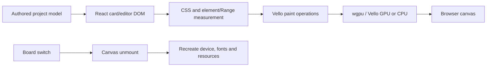
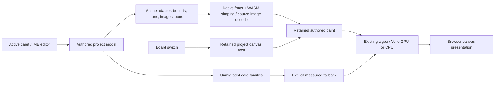
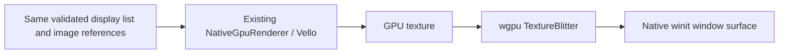

# Engine-owned canvas candidate — 2026-10-09

This implementation moves passive Graph Column v2, qualified authored Type and static artwork-image painting onto model data, and keeps the canvas host alive across board changes. It does **not** finish migration of every card family or qualify the isolated prototypes' physical-4K targets. The Settings, Saving, Codex and prototype 2.5 shell remain in place.

## What changed

- `src/board/modelArtwork.ts` projects saved Type runs and asset references into plain authored data. Parsing detached saved HTML is permitted; mounted CSS, element rectangles, Range line breaks and editor measurements are absent from this paint contract.
- `src/project-b/p0-surface/modelArtworkPaint.ts` resolves actual native font bytes, shapes through the existing WASM text engine and emits Vello glyph paths. The Rust shaping contract requires explicit model layout authority and rejects supplied measured line breaks. Area Type clips to its authored frame; point Type retains its full run. Static image pixels are decoded from their source, with dimensions taken from decoded pixels and bounded allocations.
- Graph bodies, full label text, ports and connection geometry use authored engine data. Labels are no longer silently truncated at 256 code points. Ports remain world-sized and become small when zooming out.
- `modelPaintRetention.ts` keeps content keys independent of position/order/selection. Pure movement translates retained operations; edits to text, style, size, rotation or image source invalidate them. Model paint survives unrelated DOM ownership/style and board membership changes. Unqualified measured paint retains conservative invalidation.
- The model-paint LRU holds at most 128 entries under the shared memory budget, with explicit resource leases/pins. A checked GPU-image LRU admits at most 16 MiB/128 references including active demand; active resources take priority. Optional inactive retention is dropped before active admission fails. This does not render or decode inactive boards.
- Image revision identity changes when either asset metadata or its resolved source changes, including a relocated source with the same asset object. Old pixels cannot masquerade as a current asset.
- `CanvasPane` was keyed by board ID, destroying the renderer, fonts and caches on every board switch. It is now keyed by project ID. Board selection, tools, drafts and gestures reset independently; pending camera changes are committed to the outgoing board. Board return retains the GPU session and reusable images.
- Active Type editing keeps the DOM editor for caret, selection and IME. Focusing it revokes passive engine ownership; leaving it restores model painting. This separates editing from passive painting rather than hiding an editor behind engine pixels.
- Overlapping close, capture-finally and frame retirement could free a WASM text engine twice. Painter and mounted-host cleanup are now idempotent, late font replies are rejected before using a freed host, and disposal cannot restart measured fallback. Actual-WASM tests cover double cleanup and pending native-font replies for both authored Type and graph labels. The native smoke also checks new crash-log entries through window cleanup; older failed-development entries remain preserved.

## Architecture before this change

## Current hybrid architecture

## Native-window evaluation

`engine/native-canvas-probe` is a separate bounded correctness executable using the **existing** Vello adapter and the exact authored glyph/image/graph display list from the real WASM fixture. It presents three camera frames through a winit window and native wgpu surface. Presentation has no pixel readback; one explicit first-frame test readback verifies source image pixels.

The 640 × 390 probe passed on Vulkan with an RTX 4080 SUPER. All three frames had checked allocation receipts and zero allocation-failure flags. The second and third frames reused the scene; cumulative atlas uploads stayed at one. Source image pixels matched the CPU fixture. This proves a viable native presentation path, **not** a production native editor, full-app speed comparison, browser performance ceiling or 4K acceptance.

Production native integration would still require a canvas/window host contract for resize/DPI, coordinates and input, accessibility/IME, selection and floating overlays, device recovery, consistent surface composition and native edit/save/export fixtures. The existing shell can remain while the canvas moves; replacing all UI is not implied. A wholesale WebView removal is not justified by this small probe.

## Evidence and limits

- Required `npm run build:v2` checks pass, including the new model-artwork correctness gate. Source/WASM binary provenance is retained.
- `output/playwright/model-owned-artwork/report.json`: actual WASM text shaping, actual native font bytes and Vello CPU pixels. Poisoned CSSOM/element/Range measurement calls counted **zero** during authored painting. Three complete objects, explicit unsupported-markup/effect rejection, source-change invalidation, translation reuse and budget cleanup checked.
- `output/playwright/model-owned-artwork/native-report.json`: the same display list in a real native wgpu window. Native pixels are in `native-gpu.png`; CPU pixels in `fixture.png`.
- `output/playwright/model-owned-native/report.json`: disposable native alpha graph/Type/PNG checks, brief pan/move, board return, active Type edit and native save/reload. The receipt must say `passed: true` before claiming this interaction gate passed. Architecture identity must match the embedded build.
- `output/architecture-investigation-2026-10-09/GEMINI_MODEL_PAINT_RECONCILED.md`: Gemini's corrected source review. Earlier hypotheses are preserved as historical evidence. Its FIFO wording is superseded by the actual LRU implementation; source relocation is additionally guarded and tested locally.
- `output/architecture-investigation-2026-10-09/GEMINI_CANVAS_VERIFIED_REVIEW.md`: Gemini acknowledged the verified candidate and identified mixed measured families, editor/passive typography transitions, synchronous pixel extraction, atlas/session memory and native host contracts as follow-up concerns. These are qualification questions, not measured causal findings. The probe presents in a real native window (its review's "headless" wording is inaccurate); monotonic atlas growth is not established by these three frames. This review predates the additional idempotent cleanup fix and final source hash.

## Remaining migration

The production backdrop now loads `engineScenePaint.ts`, not the legacy measured-card capture module. Spatial membership is supplied by the canonical model index. Saved rich text is parsed with parse5 and inline-style-parser, without DOMParser, Range or CSSOM. Native font resolution has its own DOM-independent module. Graph cards, supported rich Type paragraphs/headings/lists/marks, Notes, plain containers and supported static images can compile from authored source. Static image framing supports contain/cover/fill, crop zoom/position, flips/rotation, grayscale, opacity and the explicitly supported blends. Unsupported markup, cover-dependent cards and other unsupported families stay explicit overlays rather than silently losing content.

Connected source ports are model geometry and have a checked CPU pixel fixture. Translation of unchanged source cards reuses the weakly held source projection, including unchanged embedded-image upload identity; content/source replacements still invalidate. Whole-object paint receipts now live in the engine contract rather than the legacy measured module.

The actual model fixture additionally exercises the production compiler while CSS and geometry measurement calls throw, verifies its CPU image pixels, camera-only snapshot reuse and resource cleanup. This is a small correctness check, not complete visual fidelity or app performance acceptance. The extracted shaped-text fixture passes 15 checks using the current canonical font files.

The migration remains partial. Live video, PDF/PSD viewers, image pyramids, 3D content, frame/board-link chrome and unsupported rich constructs still require source/model providers. Interaction and active editing/IME still use DOM overlays, and accepted passive cards currently retain hidden semantic children. Browser decoding and detached Canvas2D pixel extraction also remain. Removing the production measurement pipeline does not mean the whole application is DOM-free or native-window hosted. Legacy measured modules remain compatibility test oracles and are not loaded by the production backdrop.

The 3D viewer now requests frames on load/resize/control changes and damping, stopping when controls settle instead of continually drawing while idle. The actual GLTF/WebGL fixture verifies idle frame requests stop, wheel zoom and resize wake rendering, and unmount stops callbacks without page errors (`output/playwright/model-viewer-idle/report.json`). No app latency improvement is claimed.

No deep performance or exported stress-board run was started. Exact physical 3840 × 2160 prototype requirements remain open: pan p95 16.2 ms, zoom p95 22.3 ms, first post-gesture 78.5 ms and sharp 613 ms. Tiny-fixture GPU durations and successful basic interactions cannot qualify those targets.

