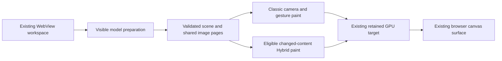

# Browser Classic/Hybrid experiment

This experiment keeps WebView2, the existing HTML canvas, pane placement,
document editor, toolbar, settings, saving and Codex integration. No native child
window or input forwarding is added. The previous alpha remains the fallback.

## Implementation

The optional `browser-hybrid` WASM build and `VITE_VELLO_DUAL=1` candidate use one
existing browser wgpu device, queue, output texture and presentation surface.
Hybrid samples the application's existing premultiplied image atlas pages.
It does not decode or re-upload those images. Both renderers have persistent
working resources; Hybrid's additional GPU working memory is not yet measured.

Camera movement, resize and active gestures select Classic. A 180 ms movement
hold avoids immediately changing backends during interaction. This policy runs
only when a frame is already requested: there is no idle timer or extra settled
refinement paint. An unchanged scene follows the retained Classic scene path.
Changed static content may use Hybrid. Gradients, shadows and unsupported blend
modes explicitly decline Hybrid and render through checked Classic.

The retained Classic source scene is now an `Arc`, so cloning its cache entry
does not duplicate that encoding on camera frames. Appending into the final
Vello scene still performs work; this does not eliminate all camera encoding.

Tile demand now maintains reverse owners for each resource. Updating one image
visits that image's old/new keys instead of rebuilding every image's demand.
Completion and retry notifications visit actual owners. Removing one owner of a
shared tile leaves its IO alive; removing the last owner cancels it. Full resource
retirement remains bounded to scene changes and disposal.

## Safety and evidence

Classic's coarse allocation status remains mandatory for Classic paint. Hybrid
has a different explicit receipt: WebGPU validation and out-of-memory scopes,
completed queue work and health checks. It does not invent Classic allocation
counts or label them as evidence about Hybrid. Product release gates still need
their own Hybrid qualification and memory policy.

The actual WASM browser smoke uses the existing supported mixed subset at
1818 x 693: images, glyph paths, shapes, connectors and clipping. It is not a
full 500-object app test and does not qualify FPS, 4K or Windows app workflows.
The frozen fixture excludes unsupported subboard model providers; ordinary app
DOM fallbacks remain as before.

Latest pixel evidence:
`D:/0/ArtEquation-Tests/2026-10-11-browser-dual/pixels-1791784995732/report.json`.
Compositor PNG comparison: mean RGBA8 channel error 0.02525, maximum 66;
0.005715 percent of channels differ by more than 32. Exact pixel parity is false.
Actual Hybrid validation, existing image-page reuse, Classic camera return,
resize and explicit gradient decline passed. Screenshots were inspected.

The earlier texture-usage failure is retained. A subsequent canvas-copy
comparison was invalidated because it read discarded swap-chain contents;
the revised test compares actual compositor PNGs and rejects blank references.
Production rendering performs no screenshot/readback work.

The backend guard suite passed 133 controlled checks, including the new policy
and Hybrid receipt boundaries. Streaming tests passed shared-owner cancellation,
queue limits and retry behavior. The 10,000-owner test establishes tile-demand
bookkeeping complexity only; it is not a card rendering benchmark.

## Remaining performance work

| Original priority | Current source and remaining work |
| --- | --- |
| Visible-only interaction | Spatial membership and cached indexes exist. Audit remaining full-array reconciliation on object edits. |
| Lazy UI preparation | Graph/structure row virtualization exists. Check remaining Layers/navigator derivation costs before expanding it. |
| Minimap | Cached posters and separate camera overlay exist. Regional content updates remain a separate change. |
| Progressive ordinary images | Two bounded image preparation lanes and tile streaming exist. Compare first preview and sharp completion on heavy boards. |
| Zoom detail stability | New rasterizer hold prevents backend thrash. Image-detail hysteresis still needs a measured workload check. |
| Retained batches/resources | Atlas sharing and constant-cost source-cache cloning added. Local batch rebuild costs remain measurable. |
| Static versus overlays | Original semantic overlays remain. Camera/drawing use Classic; no second canvas or extra refinement frame. |
| Derived graph/column cache | Preserve existing revision caches; verify graph evaluation counts remain zero during camera movement. |
| Hybrid experiment | Browser adapter implemented and small GPU correctness checked. Packaged app and heavy-board comparison remain separate gates. |

Upstream basis: [Hybrid renderer and persistent resources](https://docs.rs/vello_hybrid/0.2.0/vello_hybrid/struct.Renderer.html)
and [external texture bindings](https://docs.rs/vello_hybrid/0.2.0/vello_hybrid/struct.TextureBindings.html).
These APIs enable sharing; they do not establish an app performance improvement.

## Packaged candidate

`D:/0/ArtEquation-Tests/2026-10-11-browser-dual/build/Art-Equation-browser-dual-alpha.exe`
uses a separate copied D-drive workspace with a new identity. Source media were
copied, not moved. The previous boot-splash alpha hash remains
`6b36eab49405020c71e97b445f3f90dfe993d27d90146729b6c29fd25a7acf4a`.

Packaged startup was checked: the accepted frame reports `hybrid-0.2`, the
existing browser canvas and grid remain, and window labels contain no native
canvas pane. Workflow tests are incomplete: one could not reach its intended
context menu; the next run ended when the workspace window closed. These runs
are retained and do not qualify interaction or performance. BUILD-INFO pins
the candidate binary/WASM and these separate evidence scopes.

The initial package used an absolute Windows frontend path, which Tauri treated
as a URL. The corrected package embeds the relative private UI build directory.
This packaging repair does not change the WebView or canvas architecture.
